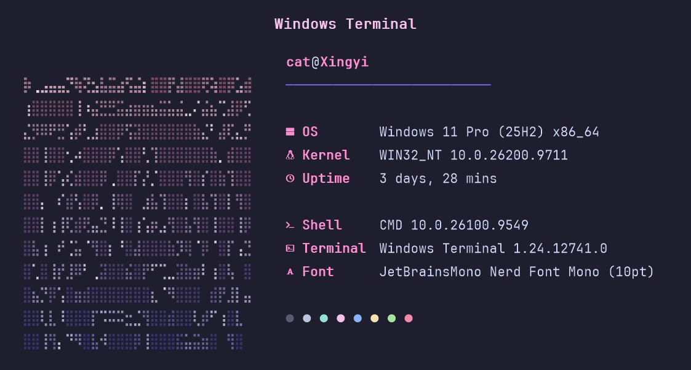
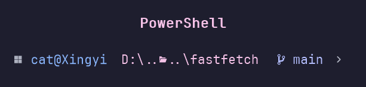

# ✿ Terminal Config

this is the folder that follows me between reinstall dates.

It's my whole Windows terminal — the fastfetch screen with a braille cat
tinted pink-to-violet, the oh-my-posh prompt, and the Windows Terminal
window holding all of it together. It all lives here with a small installer
alongside it, because every fresh Windows install I ever did ate the vibe
and got me rebuilding it by hand — and I got tired of that. This way it's
one double-click. Everything asks before touching a thing, and `no` is a
first-class answer, not an afterthought.

<div align="center">
  <br/>
  
</div>

<div align="center">
  <a href="https://github.com/RandomCatUser/terminal-config/archive/refs/heads/main.zip"></a>
  <a href="https://github.com/RandomCatUser/terminal-config"></a>
</div>

## what's in the box

| file | what it does |
| --- | --- |
| `install.ps1` | the brain — takes you step by step, asks permission |
| `install.bat` | for people who love double-clicking (it handles execution policy for you) |
| `config.jsonc` | fastfetch — what you see when you open a terminal |
| `logo.txt` | the braille cat, pre-tinted pink → violet |
| `catppuccin-mocha.omp.json` | the prompt's theme |
| `regen-logo.ps1` | repaints `logo.txt` from raw braille art |
| `Screenshots/` | what the terminal actually looks like |
| `README.md` | the notes you're reading |

## how to use it

double-click `install.bat`. if anything needs installing, you get a question
first: `y` for yes, `n` for no, enter defaults to yes. saying `n` just skips
that one piece — the rest of the setup carries on without it.

more of a manual type?

```
double-click install.bat
right-click install.ps1 → Run with PowerShell
powershell -ExecutionPolicy Bypass -File install.ps1
```

## what happens when you run it

- asks whether you want **JetBrainsMono Nerd Font**. it checks your registry
  and font folders first, so if you've already got it, it quietly says
  "already installed" and moves on. if you don't and you say yes, it
  downloads the family straight from the
  [nerd-fonts release](https://github.com/ryanoasis/nerd-fonts/releases) and
  installs it *per-user* — no admin window, no ceremony. you can say no; the
  glyphs just wait as boxes until you pick a Nerd Font yourself.
- asks whether you want **oh-my-posh**. same pattern: winget if missing, and
  it only escalates to admin when the installer genuinely demands it.
- then, if you're in, it puts the prompt theme on disk in
  `%USERPROFILE%\.config\oh-my-posh` and points every PowerShell profile it
  finds — Windows PowerShell and PowerShell 7 — at the **local file**, so
  your prompt loads even with no internet. it also offers to restyle
  **Windows Terminal** to match: Catppuccin Mocha colors, JetBrainsMono
  Nerd Font Mono at 10pt extra-black, gentle 1.2 line height, translucent
  acrylic at 80%, a chunky `filledBox` cursor. before it edits your
  `settings.json`, it leaves a `settings.json.bak` copy right next to it —
  so there's always an undo.
- asks whether you want **fastfetch**, and if yes, winget again.
- copies the config, the logo and this readme into
  `%USERPROFILE%\.config\fastfetch`, and quietly fixes the logo path inside
  the deployed config so it always points at the deployed file.
- finally, it runs fastfetch right in front of you. that's your "it worked"
  moment.

rerun it any time — every file is hash-checked, so things that already match
report as `unchanged` and nothing is rewritten for the fun of it.

## the look

fastfetch reads `%USERPROFILE%\.config\fastfetch\config.jsonc` by default.

- keys and title in pink `#ff8fd0`
- separator in violet `#7a6bf2`
- OS · Kernel · Uptime · Shell · Terminal · TerminalFont · Colors

the prompt comes from `~\.config\oh-my-posh` — no network involved after
install. curious about another theme? drop any `*.omp.json` over
`catppuccin-mocha.omp.json` here and rerun; the profiles get re-pointed for
you.

## swapping the logo

point the two paths at the top of `regen-logo.ps1` at your raw braille art
and your deployed `logo.txt`, run it, then rerun the installer. the
`unchanged` / `deployed` readout tells you if anything actually moved.

## leaving

```
winget uninstall Fastfetch.cli.Fastfetch
```

…along with `%USERPROFILE%\.config\fastfetch` and `~\.config\oh-my-posh` if
you want the pastels gone completely. Windows Terminal keeps its own backups,
so nothing there should surprise you.

## thanks ❤

- [SleepyCatHey — Ultimate-Win11-Setup](https://github.com/SleepyCatHey/Ultimate-Win11-Setup)
  · the reason this looks the way it does. my terminal style and the
  Catppuccin Mocha oh-my-posh theme come straight out of that guide — if this
  repo made your terminal nicer, the sleepy cat deserves a star for it 😺
- [fastfetch](https://github.com/fastfetch-cli/fastfetch) · the fetch
- [oh-my-posh](https://github.com/JanDeDobbeleer/oh-my-posh) · the prompt
- [Catppuccin](https://catppuccin.com) · the palette this whole thing sits on
- [nerd-fonts](https://github.com/ryanoasis/nerd-fonts) · the glyphs
- [Windows Terminal](https://github.com/microsoft/terminal) · the glass wall
  these colors live on
